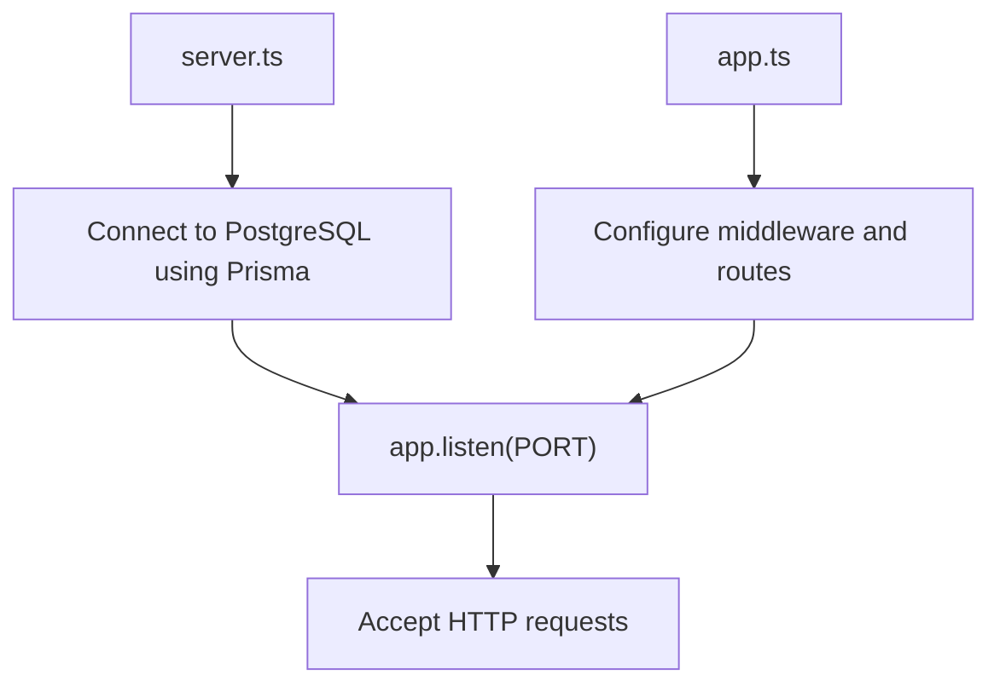
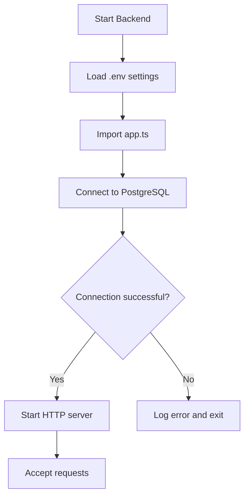
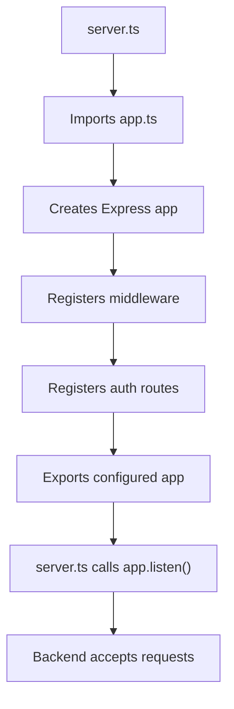
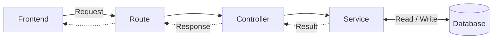

### How startup works ?

| **npm run dev** %%The Dev Command%% |
| -------------------------------------- |
| Execute server.ts                      |
| Connect to Postgress via Prisma        |
| Start Express Listening                |
If DB connection fails its log error and exits instead of making new request.

1 server.ts   starts the server — it opens the network port so the frontend can send requests.
2 app.ts       prepares the application — middleware, routes, and error handling.
3 The database connection is attempted before the server starts listening.

**Server.ts**

**app.ts**

### 2 - How Does a Request Reach the Backend ?
Imagine a user us trying to login to CompliCare.
The Request Follows the path:
Frontend -> Route -> Controller -> Service -> Database (when needed )
The Response then travel back to the Frontend. 

### 3 - What does each part do ?

**Routes- Where Should Request Go ?**
Routes checks  the requests 'URL' and 'HTTP' method and assign it to correct controller.  

**Controller- Handle The Request**
The controller receives the request and handle the functionality. 
It may read email and password from the /login request, call the service (business logic) and send back proper response. 

**Service - Apply the Main Rules**
The Service contain main business logic.
For the login it could be finding user, checking the password and deciding whether the login should succeed. 

**Database - Store and Retrieve Data**
The Database Stores information such as users and organizations. 
The Service can use prisma to read and update this information when needed. 

## 4. Why Separate These Parts?

Each part has a different responsibility.

- Routes decide which handler receives a request.
- Controllers handle the request and response.
- Services apply the application's rules.
- The database stores information.
  
Keeping these responsibilities separate makes code easier to understand, test, and maintain.

