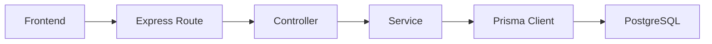

### 1) Overview 

Complicare use PostgressSQL to store data and Prisma ORM to interact with the database from our Node.js backend.

When backend starts its 1st try to established database connection if it succeed only then starts the Express Server. When an API needs data, the backend uses Prisma to communicate with PostgressSQL. 

example: During registration, the backend uses Prisma to save the new user's information in PostgreSQL.

### 2) How Does the database connection work ?

#### DATABASE_URL 

This environment variable contains the details required to connect to the database, such as the database username, password, host , port and database name. 

#### Connection pool 

A connection is a communication channel between backend and postgresSQL. A connection pool manages reusable connections so the application do not need to create a new connection for every database operation.

Our project creates it using `pg`:

```ts
const pool = new Pool({
  connectionString: process.env.DATABASE_URL,
});
```

### PostgreSQL Adapter

`PrismaPg` connects Prisma Client to the PostgreSQL driver and connection pool.

```ts
const adapter = new PrismaPg(pool);
```

#### Prisma Client

Prisma Client lets our Typescript code perform database operations without writing SQL manually for every common operations. 

```ts
export const prisma = new PrismaClient({ adapter });
```


## 3) What Does Each File Do?

| File                   | Responsibility                                                               |
| ---------------------- | ---------------------------------------------------------------------------- |
| `server.ts`            | Connects to the database and starts the server.                              |
| `app.ts`               | Configures Express, middleware and API routes.                               |
| `src/lib/prisma.ts`    | Creates the connection pool, adapter and Prisma Client.                      |
| `prisma/schema.prisma` | Defines database models, fields and relationships.                           |
| `prisma.config.ts`     | Configures Prisma CLI operations, including migrations and the database URL. |


### 4)  How Does an API Use the Database?

Suppose a user registers in CompliCare.



1. Frontend: Sends the registration request. 
2. Express: Receives the request.
3. Routes: Direct the request to correct handler.
4. Controller: Handles the request and response 
5. Service: Apply Business logic such as checking the duplicate email.
6. Prisma Client: Perform required database operations.
7. PostgressSQL: Stores the users data.
   
The result returns to the backend, which sends an HTTP response to the frontend.
Not every API request needs a database query; it depends on what the request does.