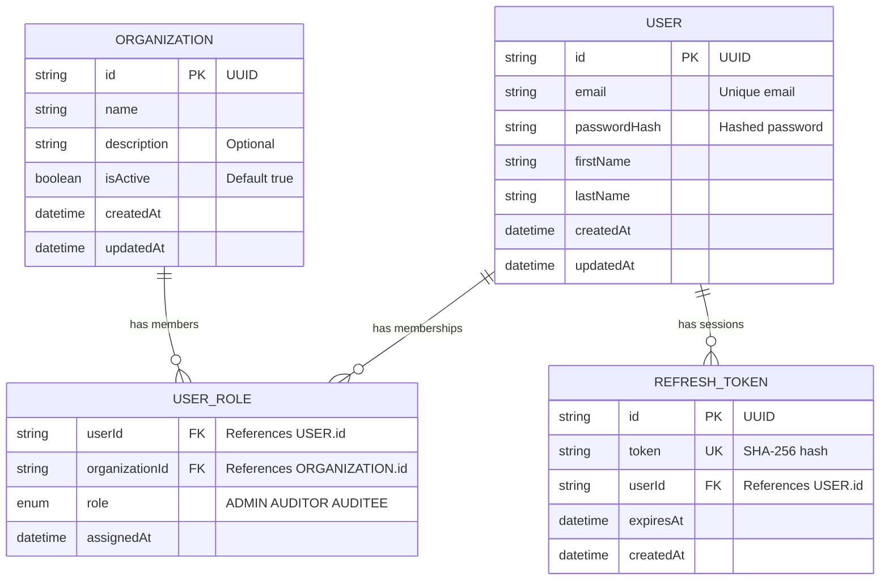
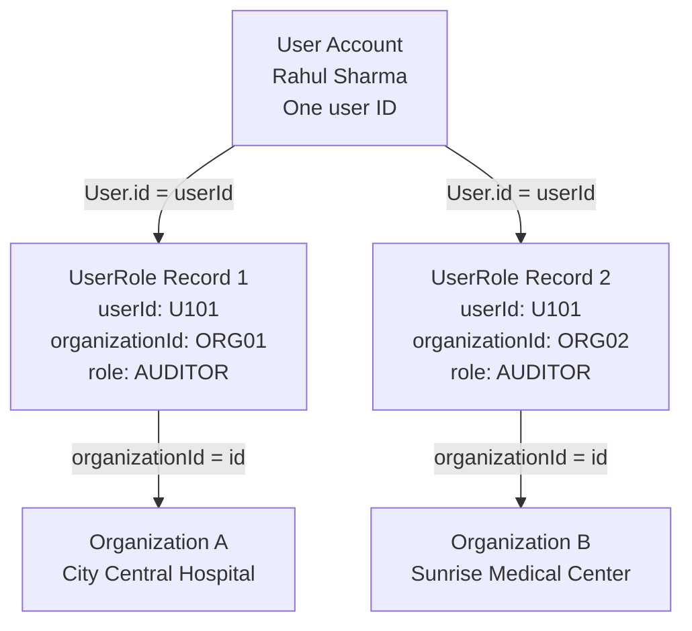
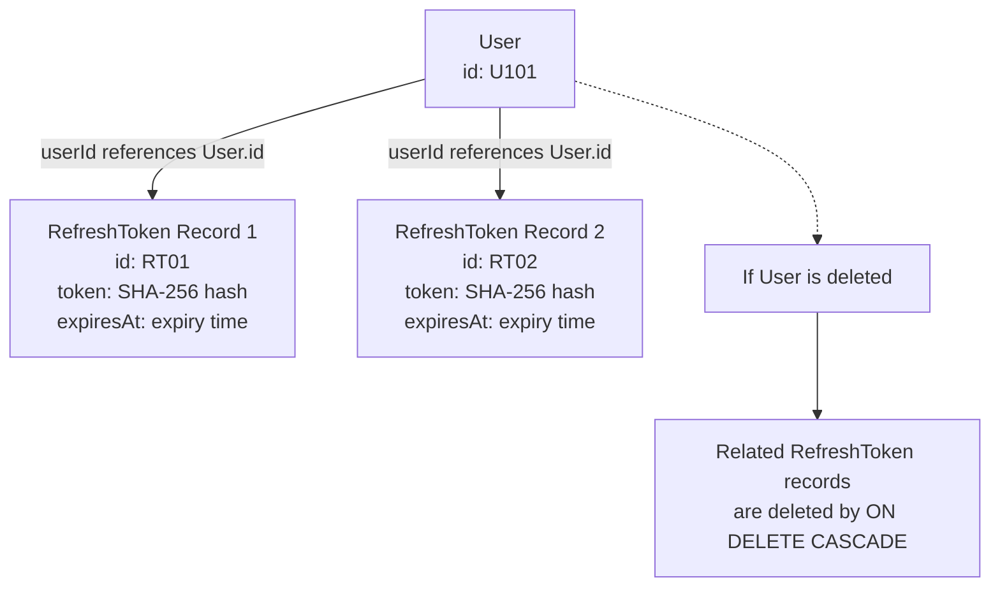

# Diagram 1 — Complete Database ER Diagram

# Diagram 2 — How membership works

 ### CompliCare — Organization Membership Flow

# Diagram 3 — Refresh-token session relationship

# CompliCare — Refresh Token Relationship

