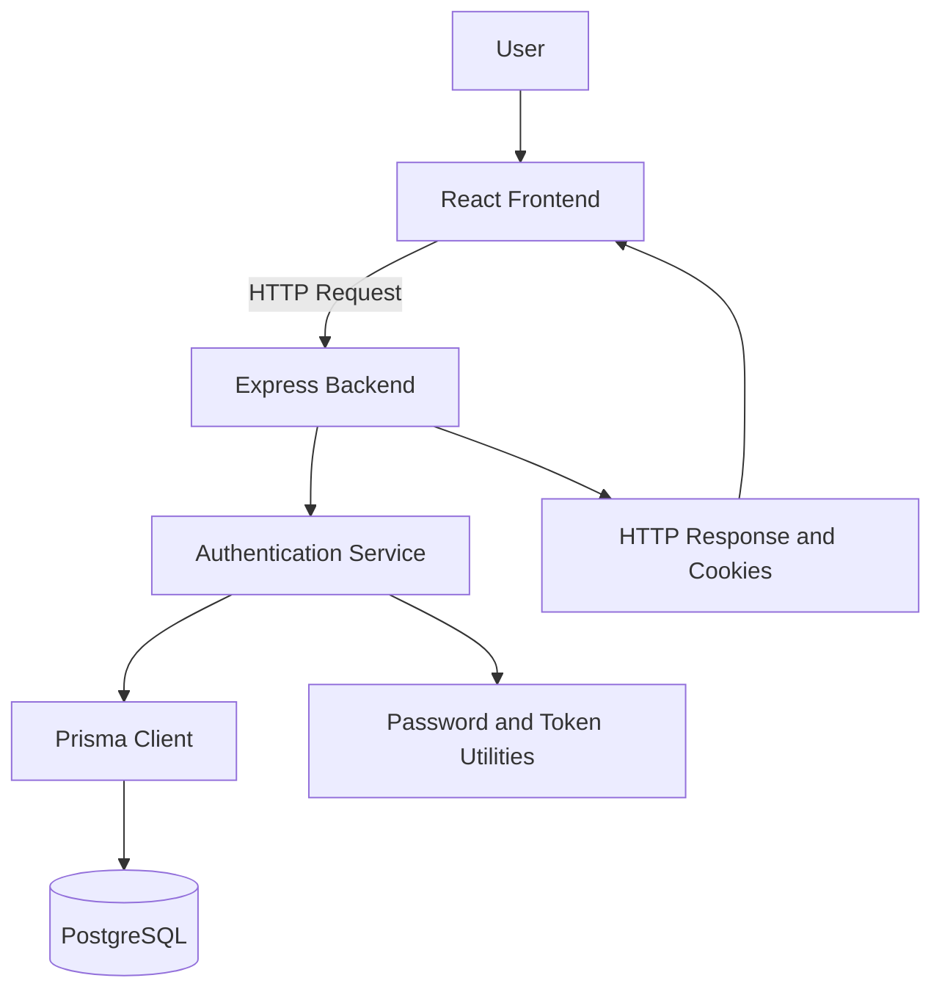
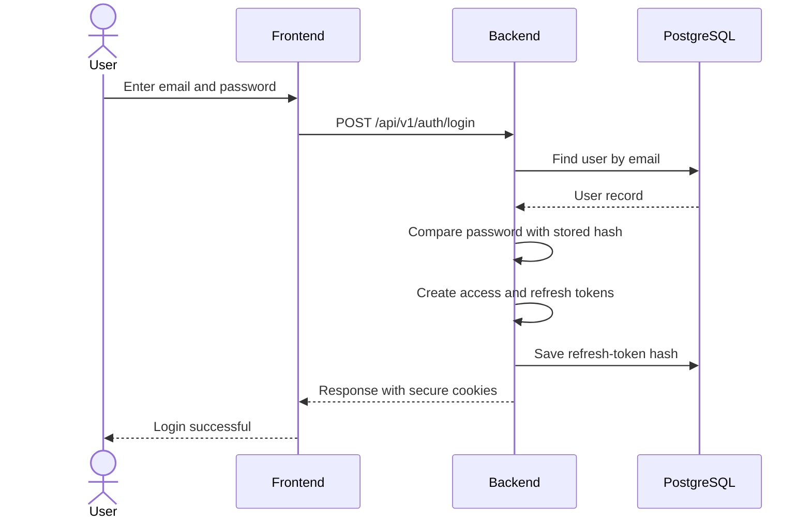
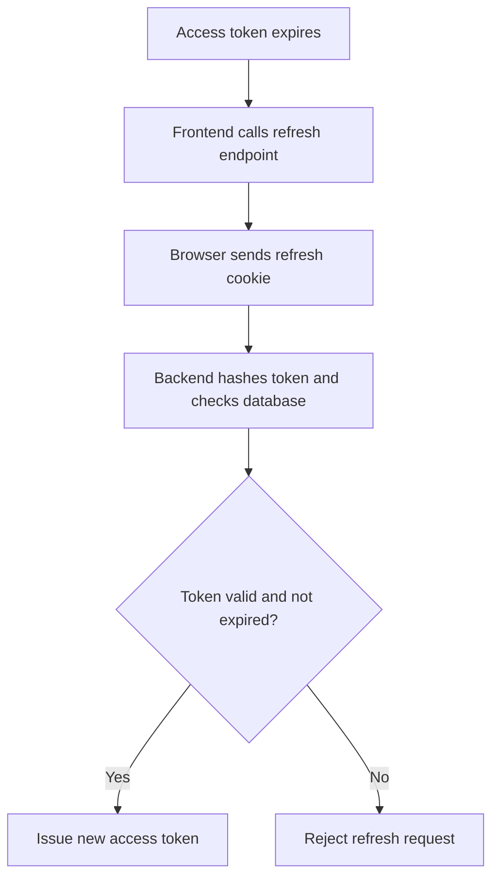

#### 1) Purpose 

Authentication verifies the identity of user and establish login session. 
In Complicare, Users must Authenticate before accessing protected apis.

**Design Goal**: Allow user to logged in securely without entering password again for every request . 

### 2) Scope
#### What Authentication Handles
- Registering a new user account.
-  Validate user email and password during login. 
-  Create and validate access and refresh tokens.
-  Maintaining login session by using  refresh tokens. 
-  Expiring sessions and handling logout. 
-  Protecting credentials and tokens. 

#### What Authentication Does Not Handle 
- **Authorization**: Deciding what user can access.
- RBAC: Managing Roles such as ADMIN, AUDITEE, AUDITOR etc..
- Business Logic
  
  These features work with authentication but solve different problems.

## 3. High-Level Architecture

#### **Responsibilities:**
- **Frontend:** Collect Login details and send it to the Backend 
- **Express backend:** Receives requests and connects them to the correct code.
- **Authentication Services:** Verifies credentials and manages authentication logic. 
- **Prisma Client:** Reads and writes database records.
- **PostgreSQL:** Stores user details and refresh-token hashes.
- **Token utilities:** Hash passwords or tokens and create or verify tokens as required.
  
  ### 4. Login Flow

If the email or password is incorrect, the backend rejects the login instead of issuing tokens.

### 5)  Access Token and Refresh Token

|Detail|Access Token|Refresh Token|
|---|---|---|
|Purpose|Access protected APIs|Obtain a new access token|
|Lifetime|15 minutes|7 days|
|Storage in our design|HTTP-only cookie|HTTP-only cookie|
|Database storage|Not stored as a session record|SHA-256 hash stored in PostgreSQL|

The Access token is JWT containing the user id  in its sub claim. 

The Refresh Token helps user to stay login and get access token without entering password again . 

##### 6. Refresh Token Flow

CompliCare uses `POST /api/v1/auth/refresh` for this operation.

The database stores the refresh token's hash rather than the original token. This reduces the risk if the database records are exposed.

### 7) Security Decisions

- **Password Hashing:** Passwords are hashed with bcrypt before storage; plaintext passwords are never stored.
- **Short-lived access tokens:** Access tokens expire after 15 minutes.
- **HTTP-Only cookies**: Browser JS cannot directly read these cookies.
- **Token Expiry:** Expired token must not be accepted.
- **Refresh Token validation:** The Backend checks the stored hash and expiry before issuing new access token.
- **Cookie security**: Production must use HTTPS and appropriate `Secure`, `SameSite` and CSRF protections.

### 8) IMP Endpoints

|Endpoint|Purpose|
|---|---|
|`POST /api/v1/auth/register`|Create a user account|
|`POST /api/v1/auth/login`|Verify credentials and start a session|
|`POST /api/v1/auth/refresh`|Obtain a new access token|
|Logout endpoint|End the session and invalidate the refresh token|
