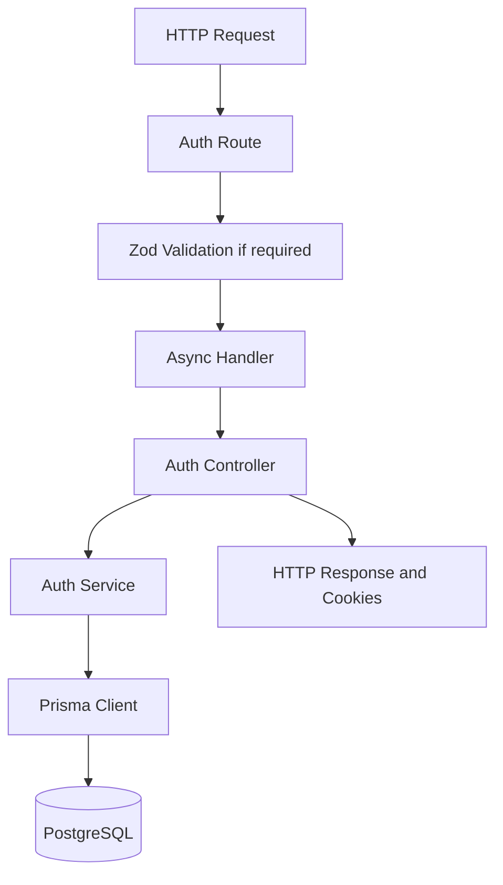

### 1) Overview 

Complicare implements authentication in the backend by using Express, Ts, Prisma, PostgressSQL, bcrypt and JWT. 

The authentication module supports 4 operations: 
1. Register
2. Login
3. Refresh access token
4. Logout

### 2) Request Flow 

### 3) Responsibilities by File

|File|Responsibility|
|---|---|
|`auth.routes.ts`|Defines authentication endpoints.|
|`auth.validation.ts`|Defines Zod rules for registration and login.|
|`auth.controller.ts`|Reads request data, sets cookies and sends responses.|
|`auth.service.ts`|Implements authentication logic.|
|`auth.types.ts`|Defines TypeScript request and response types.|
|`lib/password.ts`|Hashes passwords and compares them during login.|
|`lib/token.ts`|Generates tokens and hashes refresh tokens.|
|`lib/prisma.ts`|Provides the shared Prisma Client.|
|`error.middleware.ts`|Converts known errors into HTTP responses.|

### 4) How Each Operation Works 
 
#### Register

1. Validate the submitted data. 
2. Checks weather email already exist or not. 
3. Hash the password using bcrypt
4. Create a User in PostgressSQL through Prisma. 
5. Generate access and refresh tokens. 
6. Store Refresh token hash with expiry time. 
7. Set both tokens as cookies and return user details 
8. Send cookies to browser by HTTP-Only cookies. 

#### Login

1. Validate submitted email and password
2. Find user by email
3. Then compare the submitted password with the hashed password stored in DB. 
4. Reject invalid credentials.
5. Generate Tokens and Stores the refresh-token hash 
6. Set cookies and return the user details 

#### Refresh Access Token 

1. Read the refresh token from cookie
2. Hash it and find matching database record
3. Check the record exist and has not expired 
4. Generate a new access token
5. Set new access token cookie

#### Logout

1. Read refresh token from cookie
2. Find and delete its database record if present 
3. Clear the access token and refresh token 

### 5) Important Implementation Decisions 
 
 - Passwords are stored as bcrypt hashes, not plaintext 
 - Access token expires in 15 mins 
 - Refresh token expires in 7 days 
 - Refresh tokens are stored as SHA-256 hashes in PostgressSQL.
 - Cookies use httpOnly: true and sameSite: 'strict'
 - secure: false` is currently configured for local HTTP development; production must use HTTPS with secure cookies.
- Registration and login use Zod validation before reaching their controllers.  

### 6) Issues, Engineering Decisions & Improvements 

#### Issue 1: Registration Was Not Atomic 
(Atomic means: All related database operations succeed together, or none of their changes are saved)

User registration involved two separate database operations: creating a user save the record and saving refresh token record. 

If the first operation succeed but the second failed, the user could remain in the database even though registration did not complete successful. 

**Severity:** Data consistency risk  
**Area:** Backend · Authentication · Database  
**Status:** Implemented; normal flows verified

#### Root Cause 
In the original registereUser() service, user creation and refresh-token creation were executed independently. 

There was no database transaction connecting these two operations. Therefore , a failure during refresh-token creation would not automatically undo  already created user. 

#### Solution implemented 
we wrapped both database operations in Prisma interactive $transaction().

#### Why this fix 
A database transaction group related database operations into one unit. 
- If both writes succeed, the transaction commits. 
- If either database write fails , the transaction rolled back its database changes. 

#### Learning 
- Related database writes should use transactions when they must succeed or fail together 
- A successful API response alone does not prove that every database operation is consistent 

#### ISSUE-002 — Login Brute-Force Protection
